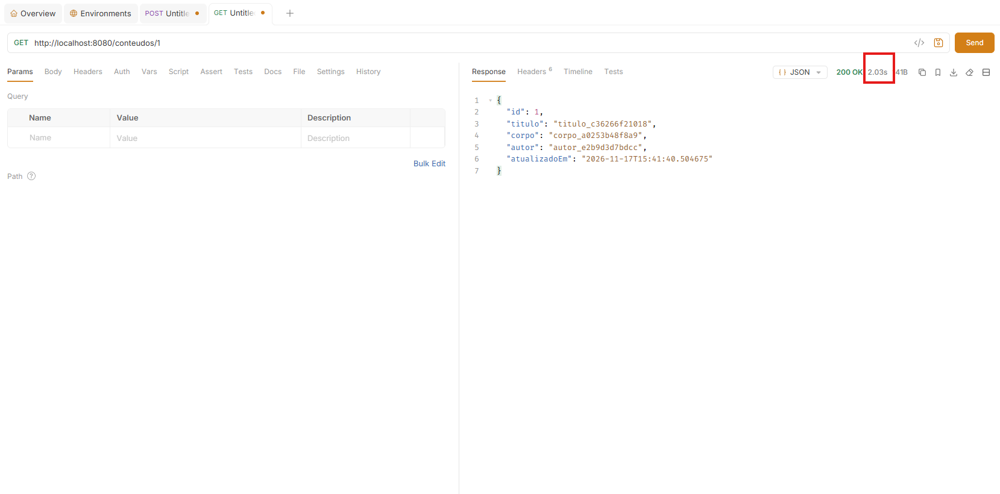
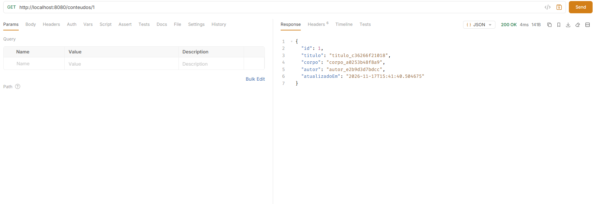
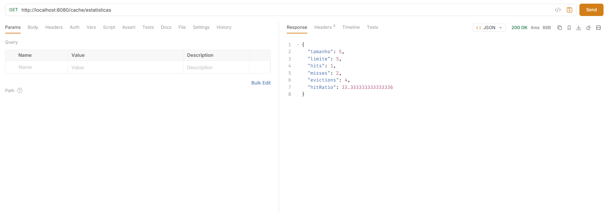

# Cache API

API simples em Spring Boot para demonstrar o uso de cache em memória em uma aplicação com banco H2.

## Como rodar

Abra o projeto na IDE e execute a classe `CacheApiApplication`.

A aplicação inicia em:

- http://localhost:8080

Console do H2:

- http://localhost:8080/h2-console
- JDBC URL: jdbc:h2:mem:cachedb
- Usuário: sa
- Senha: vazio

## Endpoints principais

- `GET /conteudos/{id}`: busca um conteúdo. Se existir no cache, retorna rapidamente. Se não existir, busca no banco e salva no cache.
- `POST /conteudos`: cria um conteúdo e também guarda o item em cache.
- `PUT /conteudos/{id}`: atualiza o conteúdo e remove a entrada do cache.
- `DELETE /conteudos/{id}`: remove o conteúdo e também limpa o item do cache.
- `GET /cache/estatisticas`: mostra número de hits, misses, evictions e taxa de acerto.
- `DELETE /cache`: limpa todo o cache.

A resposta de `GET /conteudos/{id}` também inclui o header `X-Cache`, com valores como:

- `HIT`: item encontrado no cache
- `MISS`: item não estava em cache ou expirou
- `AINDA NÃO ACESSADO`: primeiro acesso ainda não executado

## Como o cache funciona

O projeto usa uma classe `ConteudoCache` com um mapa em memória:

- chave: id do conteúdo
- valor: objeto salvo junto com data de armazenamento e último acesso

Regras da implementação:

- o cache guarda no máximo `5` itens por padrão (`app.cache.max-itens=5`)
- cada item expira após `60` segundos (`app.cache.ttl-segundos=60`)
- quando o cache enche, o item mais antigo pelo último acesso é removido
- em caso de `MISS`, a aplicação busca no banco, simula um atraso de 2 segundos e salva novamente no cache
- em caso de atualização ou exclusão, a entrada do cache é removida para evitar dados inconsistentes

Em resumo: o sistema tenta responder do cache primeiro; se o dado não estiver lá ou estiver expirado, vai ao banco, carrega e repõe o valor na memória.

Demonstração:

Primeira chamada:

Segunda chamada:

Estatísticas do cache:
